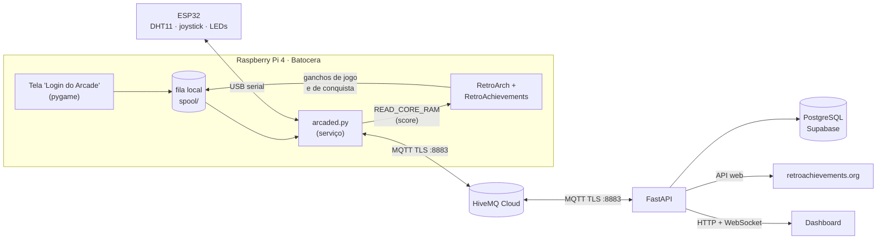

# Arcade Cloud Score

Plataforma de jogadores para um fliperama caseiro: um Raspberry Pi com **Batocera** registra cada partida,
o score lido da memória do jogo e as conquistas do **RetroAchievements**, e envia tudo via **MQTT (TLS, QoS 1)**
para um backend **FastAPI** com **PostgreSQL**. O dashboard web mostra o ranking ao vivo (WebSocket) e o perfil
de cada jogador, com histórico, recordes e uma vitrine de conquistas no estilo Steam.

Os saves também são por jogador: cada um continua de onde parou, e o progresso fica guardado na nuvem.

Projeto acadêmico — FATEC Jacareí, DSM.

## Visão geral



1. O jogador entra com usuário e senha — ou cria a conta ali mesmo — na tela **"Login do Arcade"** (sistema PYGAME
   do Batocera), pelo teclado ou pelo controle. O login vai por MQTT em desafio-resposta: a senha nunca sai do Pi.
2. Ao abrir e fechar um jogo, o Batocera chama o gancho `hook.py`, que só grava a partida numa **fila local**:
   o Batocera espera o gancho terminar antes de abrir o jogo, então ele não pode depender da rede.
3. O serviço `arcaded.py` mantém a conexão MQTT, esvazia a fila (um arquivo só sai depois do PUBACK) e, durante
   jogos mapeados, lê o score da memória pelo comando de rede `READ_CORE_RAM` do RetroArch.
4. Cada conquista desbloqueada no RetroAchievements aciona `achievement.py`, que também entra na fila.
5. No início de cada partida o gancho põe no lugar os saves de quem vai jogar; no fim, guarda o que o emulador
   gravou. O serviço sincroniza essas cópias com a nuvem.
6. O backend valida tudo com Pydantic, grava no PostgreSQL e empurra o ranking atualizado para os navegadores.
7. Um **ESP32** ligado ao Pi por USB mede a temperatura (DHT11) e lê um joystick analógico; o serviço repassa as
   leituras pelo MQTT e o **Painel IoT** do dashboard as mostra ao vivo. Pelo painel, os LEDs do ESP32 são ligados e
   desligados remotamente. No Batocera, o joystick também funciona como as setas do teclado, inclusive na diagonal.

## Tecnologias

| Camada | Linguagem | Principais tecnologias | Pasta |
|---|---|---|---|
| Front-end (dashboard web) | HTML, JavaScript, CSS | Tailwind CSS (CDN), Fetch API, WebSocket | `backend/static/` |
| Front-end (tela no fliperama) | Python | pygame | `edge/batocera/jogadores.pygame` |
| Back-end | Python | FastAPI, Uvicorn, Pydantic, paho-mqtt | `backend/` |
| Comunicação com o banco | Python + SQL | psycopg 3 com pool, SQL puro, migrações `.sql` | `backend/db.py`, `backend/migrations/` |
| Banco de dados | SQL (PostgreSQL) | PostgreSQL no Supabase | — |
| Raspberry Pi (borda/IoT) | Python, Shell, JSON | Batocera, RetroArch, paho-mqtt, serial USB (termios) | `edge/batocera/` |
| Microcontrolador (ESP32) | C++ (Arduino) | Arduino-ESP32 3.x, DHT sensor library, PWM (LEDC) | `edge/esp32/` |
| Mensageria | — | MQTT sobre TLS, QoS 1, HiveMQ Cloud | — |

## Estrutura

```
.
├── README.md
├── requirements.txt         # dependências Python do back-end e do publisher
├── .env.example             # modelo de configuração (o .env real não vai para o git)
├── docs/                    # documentação técnica (ver índice abaixo)
│
├── backend/                 # SERVIDOR — Python (FastAPI)
│   ├── main.py              # ponto de entrada: MQTT (assinante), REST, WebSocket
│   ├── auth.py              # contas: cadastro, login, sessão por cookie, perfil
│   ├── db.py                # comunicação com o PostgreSQL: pool, migrações e consultas
│   ├── ra.py                # cliente da API web do RetroAchievements (com cache)
│   ├── migrations/          # esquema do banco — SQL (001..006, aplicado na subida)
│   └── static/              # FRONT-END — HTML, JavaScript, CSS
│       ├── index.html       # ranking ao vivo
│       ├── login.html       # entrar / criar conta
│       ├── perfil.html      # perfil: estatísticas, conquistas, recordes, saves
│       ├── iot.html         # painel IoT: temperatura, joystick e LEDs do ESP32
│       └── arcade.js, arcade.css
│
└── edge/                    # BORDA (IoT) — Python, Shell e C++
    ├── publisher.py         # publicador manual para testes (contrato arcade/scores/submit)
    ├── esp32/arcade_esp32/  # firmware do ESP32 — C++ (arcade_esp32.cpp; o .ino é o que a Arduino IDE abre)
    └── batocera/            # cliente instalado no Raspberry Pi
        ├── install.sh       # instala/atualiza tudo no Pi via SSH
        ├── arcaded.py       # serviço: MQTT, fila, leitura de score, saves, avisos de jogo ao ESP32
        ├── esp32.py         # ponte USB-serial com o ESP32 (telemetria e comandos dos LEDs)
        ├── hook.py          # gancho de início/fim de jogo
        ├── saves.py         # troca dos saves por jogador
        ├── achievement.py   # gancho de conquista
        ├── common.py        # caminhos e utilidades compartilhados
        ├── jogadores.pygame # tela "Login do Arcade" (entrar, criar conta, convidado)
        ├── memory_maps.json # onde ler score/fase de cada jogo (por hash da ROM)
        └── arcade_score, arcade-score.sh, arcade-achievement.sh   # serviço e ganchos (Shell)
```

## Documentação

A pasta [`docs/`](docs/README.md) detalha cada parte do projeto:

| Documento | Conteúdo |
|---|---|
| [Estrutura de pastas](docs/estrutura-de-pastas.md) | O que é cada pasta e arquivo, e em que linguagem está escrito |
| [Tecnologias](docs/tecnologias.md) | Linguagens, frameworks e protocolos de cada camada |
| [Funcionalidades](docs/funcionalidades.md) | O que o sistema faz, com as regras e onde está implementado |
| [Arquitetura](docs/arquitetura.md) | Componentes, fluxos passo a passo e modelo de concorrência |
| [Contratos](docs/contratos.md) | Referência da API REST, do WebSocket e das mensagens MQTT |
| [Banco de dados](docs/banco-de-dados.md) | Diagrama ER, tabelas, restrições e migrações |
| [Raspberry Pi](docs/raspberry-pi.md) | O cliente do fliperama: instalação, arquivos no Pi e diagnóstico |

Os prints de todas as telas (dashboard no computador e no celular, painel IoT e as telas da TV) ficam em
[`prints/`](prints/).

## Contratos MQTT

Todos os tópicos usam **QoS 1**, menos a telemetria do ESP32 e os comandos dos LEDs, que são ao vivo (QoS 0: com o
arcade desligado, nada fica guardado para ser aplicado horas depois). Como QoS 1 entrega "pelo menos uma vez", toda mensagem de partida traz um
`play_uuid` gerado no Pi, e o banco descarta repetições pelo `UNIQUE`.

| Tópico | Sentido | Conteúdo |
|---|---|---|
| `arcade/devices/<id>/login` | Pi → servidor | `{request_id, ts, action}` com `action` = `challenge`, `login` (prova), `register` ou `logout` |
| `arcade/devices/<id>/commands` | servidor → Pi | `challenge`, `login_ok`/`login_error`, `register_ok`/`register_error`, `logout_ok`, `save_file`, `led` ou `led_mode` |
| `arcade/devices/<id>/events` | Pi → servidor | início/fim de partida (abaixo) |
| `arcade/devices/<id>/achievements` | Pi → servidor | `{achievement_id, title, description, play_uuid, username, unlocked_at}` |
| `arcade/devices/<id>/saves` | Pi → servidor | `upload` de um arquivo de save (base64) ou `manifest` (lista do que o Pi tem, no login) |
| `arcade/devices/<id>/telemetry` | Pi → servidor | leitura do ESP32: `{temperature, humidity, x, y, leds: {green, yellow, red}, mode, playing}` |
| `arcade/scores/submit` | qualquer → servidor | contrato original, usado pelo `edge/publisher.py` |

Evento de partida (`start` e `stop` trazem os mesmos dados, então o `stop` funciona mesmo se o `start` se perdeu):

```json
{
  "play_uuid": "3f1c9a2e-6d4b-4c8a-9e21-7b5d0f8a1c33",
  "event": "stop",
  "system": "megadrive",
  "rom": "Sonic The Hedgehog (USA, Europe).zip",
  "title": "Sonic The Hedgehog",
  "rom_md5": "1bc674be034e43c96b86487ac69d9293",
  "username": "thiago",
  "started_at": 1790697726,
  "ended_at": 1790697810,
  "score": 700,
  "stage_reached": 1
}
```

`username: null` é convidado (ninguém logado). `score` só aparece no `stop` de jogos com mapa de memória.

Contrato original (`arcade/scores/submit`):

| Campo | Tipo | Regra |
|---|---|---|
| `device_id` | str | obrigatório |
| `player_tag` | str | 1 a 3 letras maiúsculas ou números |
| `game` | str | não vazio |
| `score` | int | ≥ 0 |
| `stage_reached` | int | ≥ 0 |
| `timestamp` | int | epoch em segundos |

Payload inválido (JSON quebrado ou fora das regras) é registrado como `Payload rejeitado` e descartado, sem derrubar
o assinante.

## Banco de dados

Todas as tabelas ficam no schema **`arcade`** (no Supabase, o schema `public` é exposto pela API REST com a chave
pública). As migrações em `backend/migrations/` rodam sozinhas na subida do backend, cada uma uma única vez.

| Tabela | O que guarda |
|---|---|
| `users` | contas (`username`, `player_tag`, `password_hash` em scrypt) |
| `auth_tokens` | sessões do dashboard (só o SHA-256 do token) |
| `devices` | aparelhos (`device_id` = arcade) |
| `device_sessions` | quem está/esteve logado em cada aparelho |
| `games` | jogos por `(system, rom)`, com o jogo correspondente no RetroAchievements |
| `plays` | cada partida (`uuid`, jogador ou convidado, início, fim) |
| `scores` | score e fase de uma partida |
| `achievements`, `user_achievements` | conquistas do RA e quem desbloqueou cada uma |
| `ra_hashes` | cache da lista oficial de hashes de ROM do RA |
| `saves` | versão mais recente de cada arquivo de save de cada jogador |
| `telemetry` | temperatura e umidade do ESP32, uma leitura por minuto por aparelho |

Todas têm `created_at`/`updated_at`; um trigger atualiza `updated_at` só quando a linha realmente muda.

## Pré-requisitos

- Python 3.12+ (desenvolvido em 3.14) na máquina do backend.
- **HiveMQ Cloud Serverless**: crie um cluster e duas credenciais com permissão **Publish and Subscribe** —
  uma para o Pi (ex.: `arcade-pi`) e uma para o backend (ex.: `arcade-backend`). Copie o host do cluster.
- **PostgreSQL**: um projeto no Supabase (prefira a região São Paulo, `sa-east-1`). Em **Connect → Session pooler**,
  copie a connection string e troque `[YOUR-PASSWORD]` pela senha do banco.
- **RetroAchievements** (opcional, para conquistas e score): uma conta em
  [retroachievements.org](https://retroachievements.org/createaccount.php) e a *Web API Key* dela
  (Configurações → Keys).
- **Raspberry Pi com Batocera** na mesma rede, com SSH (vem ativo no Batocera).

## Instalação

```bash
python3 -m venv .venv
source .venv/bin/activate
pip install -r requirements.txt
cp .env.example .env    # e preencha com os seus valores
```

Variáveis do `.env`:

| Variável | Uso |
|---|---|
| `MQTT_HOST`, `MQTT_PORT` | broker HiveMQ (porta 8883) |
| `MQTT_USER`, `MQTT_PASS` | credencial do Pi (também usada pelo `publisher.py`) |
| `MQTT_BACKEND_USER`, `MQTT_BACKEND_PASS` | credencial do backend (se omitidas, usa as do Pi) |
| `MQTT_TOPIC` | tópico do contrato original (`arcade/scores/submit`) |
| `DATABASE_URL` | connection string do PostgreSQL (TLS é exigido por padrão) |
| `RA_API_KEY` | chave da API web do RetroAchievements (opcional) |

## Como rodar

**Backend e dashboard:**

```bash
source .venv/bin/activate
cd backend && python -m uvicorn main:app
```

Abra `http://localhost:8000`: ranking ao vivo, **ENTRAR** para criar conta ou entrar, e o perfil com conquistas.

**Cliente no Pi** (uma vez, e de novo sempre que mudar algo em `edge/batocera/`):

```bash
# acesso por chave (só na primeira vez; a senha padrão do root no Batocera é "linux")
ssh-keygen -t ed25519 -N "" -f ~/.ssh/arcade_pi
ssh-copy-id -i ~/.ssh/arcade_pi.pub root@<ip-do-pi>

edge/batocera/install.sh <ip-do-pi> arcade-pi-01
```

O instalador copia o código (e a `paho-mqtt`, já que o Batocera não tem pip), gera a configuração do Pi a partir
do `.env`, instala os ganchos, cria a entrada **"Login do Arcade"** no sistema PYGAME, liga os comandos de rede
do RetroArch (necessários para ler o score) e o modo encore, e ativa o serviço `arcade_score` no boot.

**RetroAchievements no Pi:** na TV, **Start → Configurações de jogos → RetroAchievements**: ative, informe
usuário e senha, confira **Encore ligado** e deixe **Hardcore desligado** (senão os save states param de funcionar).
Sem uma conta RA ativa o RetroArch não libera a leitura de memória, então não há score nem conquistas.

**Publicador manual** (testar o backend sem o Pi):

```bash
python edge/publisher.py                                  # interativo
python edge/publisher.py --tag THI --game "Street Fighter II" --score 142500 --stage 8
```

## Login no arcade

A tela **Login do Arcade** tem entrar, criar conta e jogar como convidado. Pelo teclado, é só digitar (setas ou Tab
para trocar de campo, Enter para confirmar); pelo controle, um teclado virtual aparece na tela.

A senha nunca trafega pelo MQTT — nem no login, nem no cadastro:

1. O Pi pede um desafio para o usuário; o servidor devolve os parâmetros do scrypt da conta (salt, N, r, p) e um
   **nonce de uso único**. Usuário inexistente recebe um salt falso e estável, então a resposta não revela quem tem conta.
2. O Pi calcula `scrypt(senha, salt)` localmente (~0,5 s num Raspberry Pi 4) e envia só a prova
   `HMAC(resultado, nonce:aparelho:pedido)`.
3. O servidor refaz o HMAC com o hash guardado no banco. A prova não serve para outro login: o nonce é de uso único e
   a prova é presa ao aparelho e ao pedido.

No cadastro, o próprio Pi gera o salt e o hash scrypt (com os mesmos parâmetros do servidor, que recusa hashes mais
fracos) e envia o hash; a conta criada no arcade entra no site com a mesma senha, e vice-versa.

## Score pela memória do jogo

O score não sai do emulador pronto: cada jogo guarda os pontos num endereço diferente da RAM. O arquivo
`edge/batocera/memory_maps.json` diz onde ler, identificando a versão exata da ROM pelo hash no formato do
RetroAchievements:

```json
"1bc674be034e43c96b86487ac69d9293": {
  "name": "Sonic The Hedgehog (Mega Drive, USA/Europa)",
  "verified": true,
  "score":  {"address": "0xfe26", "size": 4, "format": "be_swapped", "multiplier": 10, "max": 9999990},
  "stage":  {"address": "0xfe11", "size": 1, "map": {"0": 1, "2": 2, "4": 3, "1": 4, "3": 5, "5": 6}},
  "active": {"address": "0xf601", "size": 1, "in": [12, 16]}
}
```

- `format`: `be`, `le`, `bcd`, `bcd_le` ou `be_swapped` (Mega Drive: o RetroArch expõe a RAM com os bytes de
  cada palavra de 16 bits trocados).
- `multiplier`/`add`/`map`: ajustam o valor bruto (o Sonic guarda score ÷ 10; `map` põe as zonas na ordem do jogo).
- `max`: leituras acima são descartadas (RAM ainda não inicializada na tela de título).
- `active`: o score só conta nesse modo de jogo — **os modos demonstração pontuam sozinhos**.

O daemon guarda o **melhor score da partida** (vale o melhor "continue") e o anexa ao evento de fim de jogo.

Jogos com score verificado: **Sonic 1**, **Sonic 2** e **Super Mario World**. Para mapear outro, descubra os
endereços com o jogo rodando (`READ_CORE_RAM <endereço> <bytes>` via UDP na porta 55355 do Pi), acrescente a
entrada e rode o `install.sh` de novo.

## Conquistas

O arcade usa **uma conta RetroAchievements** configurada no Pi, em **modo encore** (as conquistas voltam a valer a
cada partida). Quem recebe cada conquista no nosso sistema é o **perfil logado no Pi**, uma vez por jogador; convidados
jogam com conquistas na tela, mas elas não vão para perfil nenhum.

Na primeira partida de cada ROM, o backend descobre o jogo no RA pelo hash (lista oficial por console, em cache por
7 dias) e baixa a lista completa de conquistas com ícones. O perfil mostra, por jogo, o progresso, os pontos e a
porcentagem de jogadores do arcade que desbloquearam cada conquista.

## Saves por jogador

O RetroArch usa um único arquivo por ROM (`/userdata/saves/<sistema>/<ROM>.srm`, `.state`, `.state1`…), o que
faria todo mundo dividir o mesmo progresso. No Pi, cada jogador tem sua cópia em `saves/<usuário>/<sistema>/`:

- **Início da partida**: os arquivos de quem jogou por último já estão guardados; o gancho troca pelos de quem vai
  jogar. Convidado começa com os saves de convidado, nunca com os de alguém.
- **Fim da partida**: o que o emulador gravou vai para a cópia do jogador.
- **Nuvem**: a cada 10 s o serviço envia as cópias que mudaram. No login, o Pi manda a lista do que tem e o servidor
  devolve o que estiver mais novo na nuvem — é assim que o progresso aparece em outro aparelho. Vale a versão
  gravada por último.
- **Segurança dos dados**: nenhum arquivo é apagado sem existir uma cópia igual ou mais nova; se a energia cair no
  meio da partida, o progresso é guardado na troca seguinte. Os saves que já existiam antes deste recurso vão para
  `saves/@backup-inicial/` e ficam com quem jogar primeiro.

No perfil do site, a seção **Saves na nuvem** lista os arquivos do jogador e permite baixá-los (para usar em outro
emulador, por exemplo).

## ESP32: temperatura, joystick e LEDs

Um ESP32 clássico (WROOM-32) fica ligado a uma porta USB do Raspberry Pi. Ele não usa Wi-Fi: o cabo USB leva os dados
até o `arcaded.py`, que já tem a conexão MQTT.

**Ligações** (os pinos ficam no começo do `arcade_esp32.cpp`):

| Componente | Pino do ESP32 |
|---|---|
| Joystick VRx / VRy | GPIO 4 / GPIO 15 (ADC2: só funcionam com o Wi-Fi desligado) |
| Joystick VCC / GND | 3V3 / GND |
| LED verde / amarelo / vermelho (cada um com resistor de 220 Ω) | GPIO 21 / 22 / 23 |
| DHT11 DATA | GPIO 19 (o módulo de 3 pinos já tem o resistor de pull-up; o sensor solto pede 10 kΩ do DATA ao 3V3) |
| DHT11 VCC / GND | 3V3 / GND |

**Gravar o firmware** (uma vez, com o ESP32 no computador): na Arduino IDE, abra
`edge/esp32/arcade_esp32/arcade_esp32.ino` (o código fica em `arcade_esp32.cpp`, que abre numa aba ao lado), instale pelo gerenciador as bibliotecas **DHT sensor library** e
**Adafruit Unified Sensor**, escolha a placa **ESP32 Dev Module** e clique em Carregar. Com o joystick parado, o
Monitor Serial (115200) mostra `# Pronto!` e uma linha JSON a cada leitura. Depois, é só ligar o ESP32 no Pi.

**Como funciona:**

- O ESP32 manda uma linha JSON quando o joystick mexe (até 10 por segundo, ou na hora quando ele cruza o limite das
  setas) e a cada leitura do DHT11 (a cada 2 s).
  O `esp32.py` procura a placa em `/dev/ttyUSB*` e `/dev/ttyACM*`, repassa cada leitura para
  `arcade/devices/<id>/telemetry` e volta a procurar se o cabo sair.
- O backend empurra cada leitura para o **Painel IoT** (`/iot.html`) pelo WebSocket `/ws/iot` e grava a temperatura no
  banco uma vez por minuto, o que alimenta o gráfico de 1 h, 6 h e 24 h.
- **LEDs:** no modo **joystick**, o brilho acompanha a inclinação (verde = esquerda, vermelho = direita, amarelo =
  cima/baixo). No modo **site**, um jogador logado no dashboard liga e desliga cada LED. O comando sai do backend por
  `arcade/devices/<id>/commands` (`led` ou `led_mode`), o Pi o repassa pela serial (`LED green 255`, `MODE joystick`) e
  o ESP32 responde com uma leitura nova, que confirma a mudança no painel.
- **Modo jogo:** enquanto houver um jogo aberto no Batocera, os LEDs piscam, revezando três efeitos a cada 3 s
  (perseguição verde → amarelo → vermelho, os três piscando juntos e uma onda suave). O `arcaded.py` confere a cada
  segundo o `current_play.json` do gancho (a tela de login não conta) e a API do EmulationStation, e avisa o ESP32
  com `GAME on` / `GAME off`. Se o ESP32 reiniciar no meio do jogo, a leitura dele (`playing`) mostra o estado errado
  e o aviso é reenviado. A animação tem prioridade: durante o jogo, o site não comanda os LEDs (o backend responde
  409), e no fim deles voltam ao modo anterior.
- **Joystick no Batocera:** o `esp32.py` cria um teclado virtual (uinput) e o joystick aperta as setas: acima de 110
  (na escala -255..255) a seta aperta, abaixo de 80 ela solta, para não ficar piscando com a alavanca parada perto do
  limite. Na diagonal, duas setas ficam apertadas juntas. Como o sistema o vê como um teclado, ele anda nos menus do
  EmulationStation, na tela de login e nos jogos sem configurar nada (o RetroArch usa as setas como direcional do
  jogador 1). Se o cabo sair com a alavanca inclinada, as setas são soltas.

## Decisões técnicas

- **QoS 1 + idempotência**: o broker pode reentregar; o `play_uuid` gerado no Pi e `UNIQUE` no banco garantem que
  nada duplica.
- **`clean_session=False` com client_id fixo**: backend e Pi têm sessão persistente no broker; mensagens QoS 1 enviadas
  enquanto um deles está desligado chegam quando ele volta.
- **Fila local no Pi**: o Batocera espera os ganchos terminarem, então eles só gravam arquivos; o serviço envia quando
  houver rede. Nada se perde com o Wi-Fi fora.
- **Login por desafio-resposta**: o broker não restringe tópicos por credencial, então nada secreto passa por ele —
  só salt, nonce e uma prova de uso único.
- **Ponte thread → asyncio**: os callbacks do paho rodam numa thread própria; o broadcast do WebSocket é agendado no
  event loop com `asyncio.run_coroutine_threadsafe`, e as consultas remotas saem do loop com `asyncio.to_thread`.
- **WebSocket em vez de polling**: o ranking chega ao navegador no instante em que o score é gravado.
- **Schema `arcade`**: no Supabase, o `public` é exposto pela API REST com a chave pública.
- **Contas**: senha com scrypt (parâmetros da OWASP), login com tempo constante (não revela se o usuário existe),
  sessão em cookie `HttpOnly` + `SameSite=Lax`, só o hash do token no banco.
- **RetroAchievements**: chamadas à API numa fila própria, fora da thread do MQTT, e com cache no banco, como a API pede.
- **Relógio do Pi**: o Raspberry Pi não tem relógio com bateria, e o Batocera só salva a hora (`fake-hwclock`) ao
  desligar pelo menu; desligando na tomada, todo boot começava numa data antiga até o `ntpd` acertar pela internet.
  O `arcaded.py` salva a hora a cada 10 minutos, segura partidas e conquistas na fila até a hora ser confiável e, ao
  enviar, corrige os horários pelo relógio monotônico (que não pula). O `hook.py` refaz o início da partida no
  `gameStop`, e o "stop" atualiza o início no banco: um jogo que atravessa o acerto não dura semanas.

## Limitações conhecidas

- **Clientes WebSocket em memória**: funciona com um processo do uvicorn; para vários processos seria preciso um
  pub/sub entre eles (ex.: Redis).
- **HiveMQ Cloud Serverless não restringe por tópico**: com Publish and Subscribe, uma credencial consegue ler
  todos os tópicos. Por isso o login não envia a senha; mas o cadastro pelo Pi envia o hash scrypt, e quem obtiver
  esse hash (pelo broker ou pelo banco) poderia gerar provas válidas para entrar no arcade — não no site, que exige a
  senha. Um ataque de dicionário contra o hash continua caro (scrypt).
- **Uma conta RetroAchievements para todos**: no site do RA tudo aparece como da conta do arcade (as regras do RA
  pedem uma conta por pessoa).
- **Score só em jogos mapeados e compatíveis com o RetroAchievements**: a leitura de memória depende das conquistas
  ativas. Doom (PrBoom), N64 (emulador standalone), Mortal Kombat e Street Fighter 5 (Hack) ficam só com histórico.
- **Comandos de rede do RetroArch** ficam acessíveis na rede local (porta UDP 55355).
- **Segurança do Pi**: troque a senha padrão do root do Batocera (`linux`); o acesso de manutenção usa só a chave SSH.
  O Batocera guarda a senha da conta RA em texto no `batocera.conf`.
- **Sem recuperação de senha**: o cadastro não pede e-mail.
- **Saves**: arquivos acima de 3 MB ficam só no Pi (o HiveMQ entrega mensagens de até ~4 MB); um save state apagado
  dentro do jogo pode reaparecer (a cópia do jogador nunca apaga nada); os saves do Doom (PrBoom) e do N64 standalone
  não seguem o padrão `<ROM>.*` e não são trocados por jogador.
- **Confiança no aparelho**: depois do login, é o Pi que informa quem está jogando em cada partida; um Pi
  adulterado poderia atribuir partidas a outra conta.
- **ESP32**: um por Pi (o painel mostra um aparelho por vez). No Batocera, o joystick é só direcional (setas), sem
  botões. As leituras de quando o arcade está sem internet não são guardadas, e o histórico tem uma leitura por
  minuto. O DHT11 tem precisão de ±2 °C.
- **Login offline**: sem conexão com o servidor não dá para entrar (a senha é conferida lá); dá para jogar como
  convidado.
