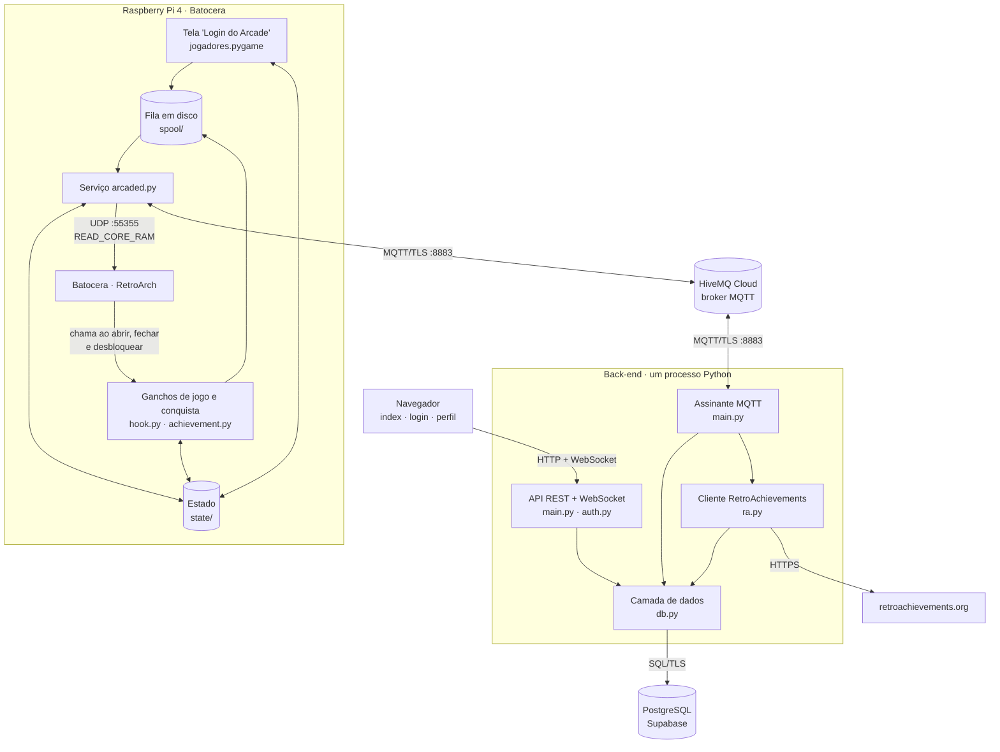
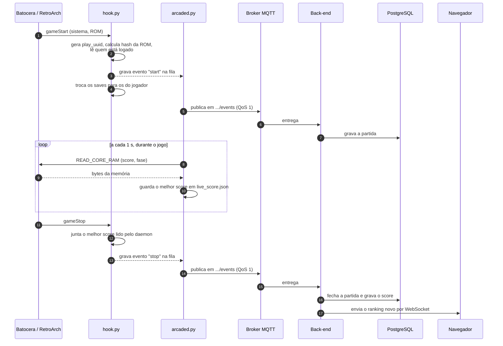
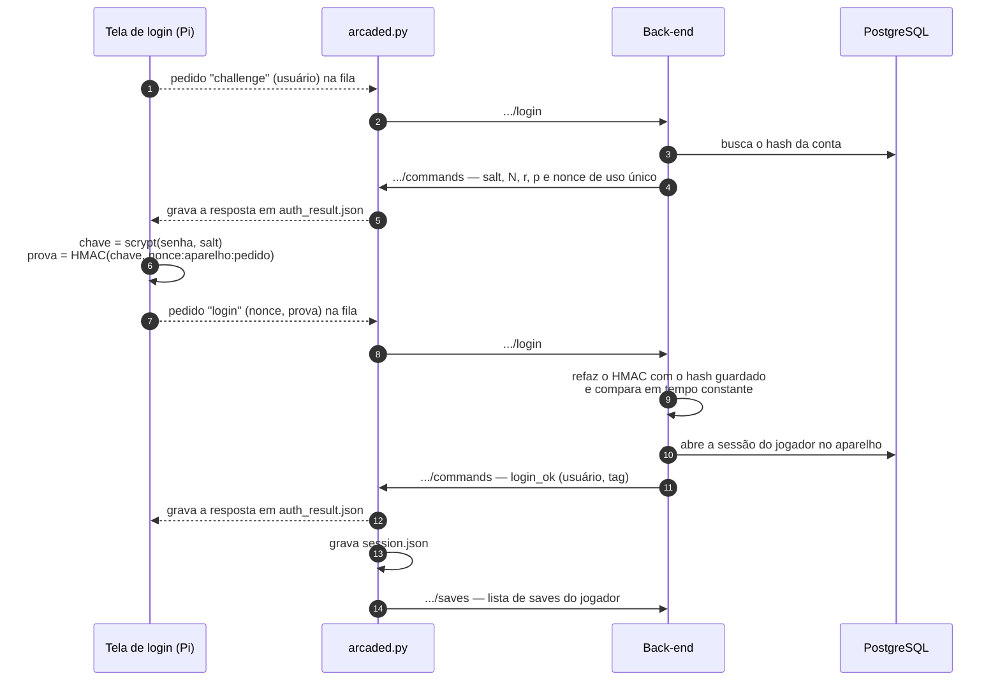
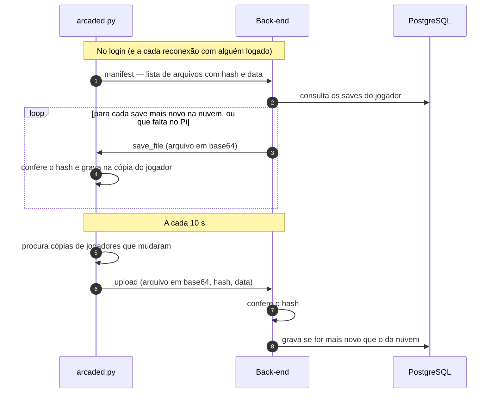

# Arquitetura

Como as partes do sistema se conectam e o que acontece, passo a passo, em cada fluxo principal.

## Componentes

Três ideias sustentam o desenho:

1. **O Pi e o servidor nunca se conectam um ao outro.** Os dois fazem conexões de saída para o broker MQTT. O
   fliperama pode ficar atrás de qualquer roteador doméstico, sem IP público e sem abrir portas.
2. **No Pi, só o serviço `arcaded.py` usa a rede.** Os ganchos e a tela de login apenas gravam arquivos numa fila
   em disco. O Batocera espera o gancho terminar antes de abrir o jogo; se o gancho dependesse da rede, um Wi-Fi
   ruim atrasaria o jogo.
3. **No servidor, só o `db.py` fala com o banco.** Os demais módulos chamam funções dele.

## Fluxo de uma partida com score

Pontos importantes:

- O `play_uuid` criado no passo 2 acompanha a partida até o banco. Como o QoS 1 pode entregar a mesma mensagem
  mais de uma vez, é ele (com uma restrição `UNIQUE`) que impede duplicatas.
- O evento `stop` repete todos os dados do `start`. Se o `start` se perder, o `stop` sozinho cria a partida.
- O daemon só remove um arquivo da fila depois de o broker confirmar o recebimento (PUBACK).
- O navegador só é avisado quando um **score novo** é gravado, não a cada partida.

## Login no fliperama

A senha nunca é enviada pela rede. O broker MQTT usado não restringe tópicos por credencial, então qualquer
cliente autenticado poderia ler as mensagens; por isso só trafegam dados que não servem para entrar de novo.

- O desafio vale 60 segundos e uma única tentativa, certa ou errada.
- A prova é amarrada ao aparelho e ao pedido: capturá-la não permite entrar de outro lugar nem repetir o login.
- Para um usuário que não existe, o servidor devolve um salt falso, mas sempre o mesmo para aquele nome. A
  resposta fica igual à de uma conta real.
- A tela recusa parâmetros de scrypt exagerados, para que um servidor falso não consiga travar o Pi.
- Só depois do `login_ok` o Pi considera alguém logado (arquivo `session.json`). Uma resposta atrasada de uma
  tentativa antiga é ignorada.

No **cadastro** pelo fliperama, o Pi gera o salt e o hash scrypt e envia o hash. O servidor só aceita hashes com
os mesmos parâmetros que ele próprio usa.

No **site**, o login é o tradicional: a senha vai por HTTP(S) para o back-end, que confere com o hash.

## Sincronização de saves

O arquivo recebido da nuvem entra na cópia do jogador no Pi; é o gancho de início de jogo que o põe no lugar
onde o emulador lê, na partida seguinte.

## Modelo de concorrência

### No back-end

O processo tem três frentes de execução, e o código é escrito para que uma não trave a outra:

| Frente | O que roda nela |
|---|---|
| Laço de eventos `asyncio` | WebSocket e o envio do ranking para os navegadores |
| Thread do paho-mqtt | Os tratadores de mensagens MQTT, incluindo as gravações no banco |
| Fila do RetroAchievements (1 thread) | Chamadas à API do RA, que podem levar segundos |

As rotas REST são funções comuns (`def`), que o FastAPI executa em um pool de threads à parte.

- Quando a thread do MQTT grava um score novo, ela **agenda** o envio do ranking no laço de eventos com
  `asyncio.run_coroutine_threadsafe`.
- O envio do ranking consulta o banco fora do laço de eventos, com `asyncio.to_thread`.
- Cada tratador MQTT é protegido por `try/except`: uma exceção que escapasse derrubaria o laço do paho.
- As conexões com o banco vêm de um pool (1 a 5), compartilhado com segurança entre as threads.

Os navegadores conectados ao WebSocket ficam numa lista **em memória**. Por isso o back-end deve rodar com um
único processo do Uvicorn.

### No Raspberry Pi

| Processo | Duração | O que faz |
|---|---|---|
| `arcaded.py` | Permanente, desde o boot | Três frentes: o laço principal (fila a cada 1 s, saves a cada 10 s), a thread do paho-mqtt (recebe comandos) e uma thread que lê o score a cada 1 s |
| `hook.py` | Frações de segundo | Executa uma vez por abertura e por fechamento de jogo |
| `achievement.py` | Frações de segundo | Executa uma vez por conquista |
| `jogadores.pygame` | Enquanto a tela está aberta | Interface de login |

Esses processos trocam informação por **arquivos JSON**. Toda escrita é feita em um arquivo temporário e depois
renomeada, de modo que quem lê nunca encontra um arquivo pela metade.

## Decisões e limitações

As justificativas de cada escolha técnica e as limitações conhecidas estão no README:
[Decisões técnicas](../README.md#decisões-técnicas) e [Limitações conhecidas](../README.md#limitações-conhecidas).
