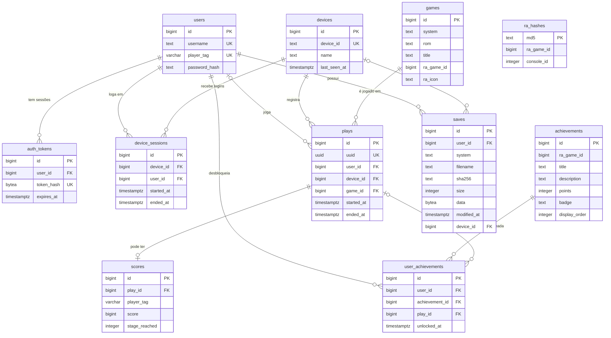

# Banco de dados

PostgreSQL, hospedado no Supabase. Toda a comunicação com o banco passa por [`backend/db.py`](../backend/db.py),
e o esquema é definido pelos arquivos SQL de [`backend/migrations/`](../backend/migrations/).

## Como o back-end se conecta

| Item | Valor |
|---|---|
| Driver | psycopg 3 |
| Pool | `psycopg_pool.ConnectionPool`, mínimo 1 e máximo 5 conexões |
| Endereço | Variável `DATABASE_URL` do `.env` (connection string do *Session pooler* do Supabase) |
| TLS | `sslmode=require` é acrescentado se a URL não definir `sslmode` |
| Formato das linhas | Dicionários (`dict_row`): cada linha vira `{"coluna": valor}` |
| Transações | Cada função abre `with pool.connection()`: confirma ao sair do bloco, desfaz se der erro |
| Conexões ociosas | Verificadas antes do uso; as derrubadas pelo provedor são descartadas |
| Comandos preparados | Desligados (`prepare_threshold=None`), para funcionar atrás de um pooler |

Se o banco estiver inacessível, o back-end falha logo na subida, em vez de subir e quebrar depois.

## Schema

Todas as tabelas ficam no schema **`arcade`**, não no `public`. No Supabase, o que está em `public` é exposto
automaticamente por uma API REST com a chave pública do projeto; manter as tabelas em outro schema evita essa
exposição.

## Diagrama

`ra_hashes` não tem chave estrangeira: é um cache da lista de ROMs do RetroAchievements. Ela se relaciona com
`games` e `achievements` pelo valor de `ra_game_id` (o ID do jogo no RetroAchievements).

## Tabelas

Todas têm `created_at` (exceto `schema_migrations`, que usa `applied_at`). As que podem ser alteradas têm também
`updated_at`, mantido por gatilho.

| Tabela | O que guarda | Uma linha é |
|---|---|---|
| `users` | Contas de jogador | Um jogador |
| `auth_tokens` | Sessões de login do site | Um login ativo em um navegador |
| `devices` | Fliperamas conhecidos | Um aparelho |
| `device_sessions` | Quem está ou esteve logado em cada fliperama | Um período de login em um aparelho |
| `games` | Jogos já vistos | Uma ROM de um sistema |
| `plays` | Partidas | Uma partida |
| `scores` | Pontuações | O score de uma partida |
| `achievements` | Catálogo de conquistas do RetroAchievements | Uma conquista |
| `user_achievements` | Conquistas desbloqueadas | Uma conquista de um jogador |
| `ra_hashes` | Cache da lista de hashes de ROM do RetroAchievements | Um hash de ROM |
| `saves` | Saves dos jogadores na nuvem | A versão mais recente de um arquivo de save |
| `schema_migrations` | Controle das migrações aplicadas | Uma migração |

### `users`

| Coluna | Tipo | Regra |
|---|---|---|
| `id` | `BIGINT` identidade | Chave primária |
| `username` | `TEXT` | Único; `^[a-z0-9_]{3,20}$` |
| `player_tag` | `VARCHAR(3)` | Único; `^[A-Z0-9]{1,3}$` |
| `password_hash` | `TEXT` | `scrypt$N$r$p$salt$hash` — os parâmetros vão junto, para poder endurecê-los depois sem invalidar senhas antigas |

### `devices`

| Coluna | Tipo | Regra |
|---|---|---|
| `id` | `BIGINT` identidade | Chave primária |
| `device_id` | `TEXT` | Único. O nome do aparelho (ex.: `arcade-pi-01`) |
| `name` | `TEXT` | Opcional |
| `last_seen_at` | `TIMESTAMPTZ` | Atualizado a cada mensagem do aparelho |

Um aparelho é cadastrado sozinho na primeira mensagem que envia.

### `games`

| Coluna | Tipo | Regra |
|---|---|---|
| `id` | `BIGINT` identidade | Chave primária |
| `system` | `TEXT` | Pasta do Batocera (`megadrive`, `snes`...) ou `manual` para o `publisher.py` |
| `rom` | `TEXT` | Nome do arquivo da ROM. `(system, rom)` é único |
| `title` | `TEXT` | Nome para exibição |
| `ra_game_id` | `BIGINT` | ID do jogo no RetroAchievements, quando identificado |
| `ra_icon` | `TEXT` | Caminho do ícone em `media.retroachievements.org` |

### `plays`

| Coluna | Tipo | Regra |
|---|---|---|
| `id` | `BIGINT` identidade | Chave primária |
| `uuid` | `UUID` | **Único. Chave de idempotência**, gerada no Pi |
| `user_id` | `BIGINT` | → `users`. `NULL` = convidado. Se a conta for apagada, vira `NULL` |
| `device_id` | `BIGINT` | → `devices`. Obrigatório |
| `game_id` | `BIGINT` | → `games`. Obrigatório |
| `started_at` | `TIMESTAMPTZ` | Obrigatório |
| `ended_at` | `TIMESTAMPTZ` | `NULL` enquanto a partida está em andamento; nunca anterior a `started_at` |

### `scores`

| Coluna | Tipo | Regra |
|---|---|---|
| `id` | `BIGINT` identidade | Chave primária |
| `play_id` | `BIGINT` | → `plays`. **Único**: no máximo um score por partida. Apagado junto com a partida |
| `player_tag` | `VARCHAR(3)` | Tag usada na partida; `???` para convidado |
| `score` | `BIGINT` | ≥ 0 |
| `stage_reached` | `INTEGER` | ≥ 0 |

### `auth_tokens`

| Coluna | Tipo | Regra |
|---|---|---|
| `id` | `BIGINT` identidade | Chave primária |
| `user_id` | `BIGINT` | → `users`. Apagado junto com a conta |
| `token_hash` | `BYTEA` | Único. SHA-256 do token do cookie — o token em si nunca é gravado |
| `expires_at` | `TIMESTAMPTZ` | 30 dias após o login. Sessões vencidas são apagadas a cada novo login |

### `device_sessions`

| Coluna | Tipo | Regra |
|---|---|---|
| `id` | `BIGINT` identidade | Chave primária |
| `device_id` | `BIGINT` | → `devices` |
| `user_id` | `BIGINT` | → `users`. Apagado junto com a conta |
| `started_at` | `TIMESTAMPTZ` | Obrigatório |
| `ended_at` | `TIMESTAMPTZ` | `NULL` = sessão aberta; nunca anterior a `started_at` |

Um índice único parcial garante **no máximo uma sessão aberta por aparelho**: um login novo encerra o anterior.

### `achievements`

| Coluna | Tipo | Regra |
|---|---|---|
| `id` | `BIGINT` | Chave primária. É o ID da conquista no RetroAchievements (não é gerado aqui) |
| `ra_game_id` | `BIGINT` | Jogo ao qual pertence |
| `title`, `description` | `TEXT` | — |
| `points` | `INTEGER` | Pontos da conquista |
| `badge` | `TEXT` | Nome do ícone |
| `display_order` | `INTEGER` | Ordem de exibição |

### `user_achievements`

| Coluna | Tipo | Regra |
|---|---|---|
| `id` | `BIGINT` identidade | Chave primária |
| `user_id` | `BIGINT` | → `users`. Apagado junto com a conta |
| `achievement_id` | `BIGINT` | → `achievements`. `(user_id, achievement_id)` é **único** |
| `play_id` | `BIGINT` | → `plays`. Partida em que ocorreu; vira `NULL` se a partida for apagada |
| `unlocked_at` | `TIMESTAMPTZ` | Quando foi desbloqueada |

### `ra_hashes`

| Coluna | Tipo | Regra |
|---|---|---|
| `md5` | `TEXT` | Chave primária. Hash da ROM |
| `ra_game_id` | `BIGINT` | Jogo correspondente |
| `console_id` | `INTEGER` | Console no RetroAchievements |

A lista de cada console é baixada de novo quando tem mais de 7 dias.

### `saves`

| Coluna | Tipo | Regra |
|---|---|---|
| `id` | `BIGINT` identidade | Chave primária |
| `user_id` | `BIGINT` | → `users`. Apagado junto com a conta |
| `system` | `TEXT` | `^[a-z0-9_]{1,32}$` |
| `filename` | `TEXT` | Sem barras e sem começar com ponto. `(user_id, system, filename)` é único |
| `sha256` | `TEXT` | Hash do conteúdo |
| `size` | `INTEGER` | Tamanho em bytes |
| `data` | `BYTEA` | O arquivo |
| `modified_at` | `TIMESTAMPTZ` | Quando o emulador gravou o arquivo |
| `device_id` | `BIGINT` | → `devices`. Aparelho que enviou a versão atual |

Só a versão mais recente de cada arquivo é guardada. Um envio só substitui o que está na nuvem se for mais novo
**e** tiver conteúdo diferente.

## Idempotência

O MQTT com QoS 1 pode entregar a mesma mensagem mais de uma vez. O banco absorve as repetições:

| Mensagem repetida | O que impede a duplicata |
|---|---|
| Início ou fim de partida | `plays.uuid` único, com `ON CONFLICT ... DO UPDATE` |
| Score de uma partida | `scores.play_id` único, com `ON CONFLICT DO NOTHING` |
| Conquista | `(user_id, achievement_id)` único em `user_achievements` |
| Save | `(user_id, system, filename)` único em `saves`, e só grava se for mais novo |
| Score avulso do `publisher.py` | UUID calculado a partir de aparelho + tag + horário: a mesma mensagem gera o mesmo UUID |

## Índices

Além dos criados pelas chaves primárias e restrições de unicidade:

| Índice | Tabela | Para quê |
|---|---|---|
| `plays_game_id_idx` | `plays (game_id)` | Ranking e recordes por jogo |
| `plays_user_id_idx` | `plays (user_id)` | Perfil do jogador |
| `scores_score_idx` | `scores (score DESC)` | Ranking |
| `auth_tokens_user_id_idx` | `auth_tokens (user_id)` | Sessões de uma conta |
| `device_sessions_open_idx` | `device_sessions (device_id)` onde `ended_at IS NULL` | Único: uma sessão aberta por aparelho |
| `device_sessions_user_id_idx` | `device_sessions (user_id)` | Histórico de logins |
| `ra_hashes_console_id_idx` | `ra_hashes (console_id)` | Renovação do cache por console |
| `achievements_ra_game_id_idx` | `achievements (ra_game_id)` | Conquistas de um jogo |
| `user_achievements_achievement_id_idx` | `user_achievements (achievement_id)` | Cálculo de raridade |

## Gatilho de `updated_at`

A função PL/pgSQL `set_updated_at()` atualiza `updated_at` antes de cada `UPDATE`, **somente se algum valor da
linha realmente mudou**. Assim, uma mensagem repetida que regrava os mesmos valores não altera a data de
modificação. O gatilho está em `users`, `devices`, `games`, `plays`, `scores`, `device_sessions`, `achievements`
e `saves`.

## Migrações

| Arquivo | Conteúdo |
|---|---|
| `001_initial.sql` | `set_updated_at()`, `users`, `devices`, `games`, `plays`, `scores` |
| `002_auth_tokens.sql` | `auth_tokens` |
| `003_device_sessions.sql` | `device_sessions` |
| `004_achievements.sql` | Colunas `ra_game_id` e `ra_icon` em `games`; `ra_hashes`, `achievements`, `user_achievements` |
| `005_saves.sql` | `saves` |

Como funcionam (`db.migrate()`, chamada na subida do back-end):

1. Cria o schema `arcade` e a tabela `arcade.schema_migrations`, se não existirem.
2. Lê quais versões já foram aplicadas.
3. Para cada arquivo `.sql` ainda não aplicado, em ordem alfabética: executa o arquivo e registra a versão,
   **dentro de uma única transação**. Se o arquivo falhar, nada dele fica aplicado.

Os arquivos não usam o prefixo `arcade.`: a migração define o `search_path` antes de executá-los.

### Para alterar o esquema

Crie um arquivo novo com o próximo número (por exemplo `006_minha_mudanca.sql`) e reinicie o back-end. **Não
edite uma migração que já foi aplicada**: o sistema registra só o nome do arquivo, então a alteração não seria
executada nos bancos que já passaram por ela.
