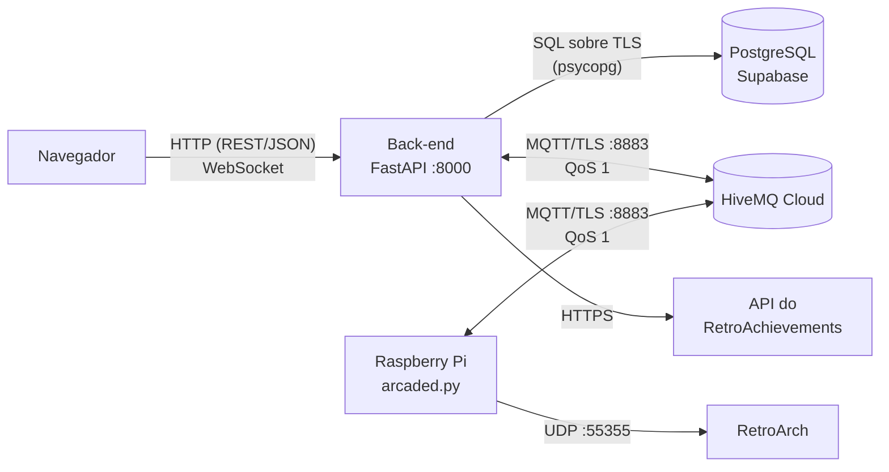

# Tecnologias por camada

Quais linguagens, bibliotecas e protocolos o projeto usa em cada parte, e por quê.

## Resumo

| Camada | Linguagem | Frameworks e bibliotecas | Onde está no repositório |
|---|---|---|---|
| **Front-end** — dashboard web | HTML5, JavaScript, CSS | Tailwind CSS (CDN), Fetch API, WebSocket API | `backend/static/` |
| **Front-end** — tela no fliperama | Python | pygame | `edge/batocera/jogadores.pygame` |
| **Back-end** | Python 3.12+ | FastAPI, Uvicorn, Pydantic, paho-mqtt, python-dotenv | `backend/main.py`, `auth.py`, `ra.py` |
| **Comunicação com o banco** | Python + SQL | psycopg 3, psycopg-pool | `backend/db.py`, `backend/migrations/` |
| **Banco de dados** | SQL, PL/pgSQL | PostgreSQL (hospedado no Supabase) | serviço em nuvem |
| **Raspberry Pi** | Python 3, Shell, JSON | Batocera, RetroArch, paho-mqtt | `edge/batocera/` |
| **Mensageria** | — | MQTT 3.1.1 sobre TLS, QoS 1 | HiveMQ Cloud (serviço em nuvem) |

## Front-end

### Dashboard web

| Item | Tecnologia |
|---|---|
| Marcação | HTML5 |
| Lógica | JavaScript puro (sem React, Vue ou similar), escrito direto nas páginas e em `arcade.js` |
| Estilo | [Tailwind CSS](https://tailwindcss.com/) carregado de `cdn.tailwindcss.com`, mais três regras em `arcade.css` |
| Dados | `fetch` para a API REST (JSON) e `WebSocket` para o ranking ao vivo |
| Build | Nenhum. Não há Node.js, npm nem empacotador: o FastAPI serve os arquivos como estão |

São três páginas: `index.html` (ranking), `login.html` (entrar/criar conta) e `perfil.html` (perfil do jogador).

**Por que sem framework:** são três telas com pouca interação. Dispensar o build deixa o projeto com uma única
linguagem de servidor e um único comando para subir tudo.

**Cuidado de segurança:** tags e nomes de jogos chegam de fora (qualquer cliente MQTT pode publicar), então todo
texto passa pela função `esc()` antes de entrar no HTML.

### Tela "Login do Arcade" (no fliperama)

| Item | Tecnologia |
|---|---|
| Linguagem | Python 3 |
| Interface | [pygame](https://www.pygame.org/) (já vem no Batocera), em tela cheia |
| Entrada | Teclado, controles reconhecidos pelo SDL2 e joysticks genéricos; teclado virtual na tela para quem usa controle |
| Criptografia | `hashlib.scrypt` e `hmac` da biblioteca padrão |

Aparece no menu do Batocera como um "jogo" do sistema PYGAME.

## Back-end

| Item | Tecnologia | Papel |
|---|---|---|
| Linguagem | Python 3.12 ou mais novo (desenvolvido em 3.14) | — |
| Framework web | [FastAPI](https://fastapi.tiangolo.com/) | Rotas REST, WebSocket e arquivos estáticos |
| Servidor | [Uvicorn](https://www.uvicorn.org/) | Servidor ASGI que executa o FastAPI |
| Validação | [Pydantic](https://docs.pydantic.dev/) v2, em modo estrito | Valida cada mensagem MQTT e cada corpo de requisição |
| MQTT | [paho-mqtt](https://eclipse.dev/paho/) 2.x | Assina os tópicos dos fliperamas e publica as respostas |
| Configuração | python-dotenv | Lê o arquivo `.env` |
| Senhas | `hashlib.scrypt` (biblioteca padrão) | Hash de senha com os parâmetros recomendados pela OWASP |
| HTTP de saída | `urllib` (biblioteca padrão) | Chamadas à API do RetroAchievements |

O back-end é **um único processo** que é ao mesmo tempo assinante MQTT, API e servidor do dashboard.

Versões instaladas no ambiente de desenvolvimento (30/09/2026) — o `requirements.txt` não fixa versões, então uma
instalação nova pode trazer números mais recentes:

| Biblioteca | Versão |
|---|---|
| fastapi | 0.141.1 |
| uvicorn | 0.54.0 |
| pydantic | 2.13.5 |
| paho-mqtt | 2.1.0 |
| psycopg | 3.3.6 |
| psycopg-pool | 3.3.3 |
| python-dotenv | 1.2.3 |

## Comunicação com o banco de dados

| Item | Tecnologia |
|---|---|
| Banco | PostgreSQL, hospedado no [Supabase](https://supabase.com/) (conexão pelo *Session pooler*) |
| Driver | [psycopg 3](https://www.psycopg.org/psycopg3/) |
| Pool de conexões | `psycopg_pool.ConnectionPool`, de 1 a 5 conexões |
| Consultas | **SQL escrito à mão**, sem ORM, sempre com parâmetros (`%s` / `%(nome)s`) |
| Migrações | Arquivos `.sql` numerados, aplicados pelo próprio back-end na subida |
| Lógica no banco | Uma função PL/pgSQL (`set_updated_at`) usada por gatilhos |
| Criptografia em trânsito | TLS obrigatório (`sslmode=require` é imposto se a URL não disser outra coisa) |

Toda a comunicação com o banco fica em **um arquivo só**, `backend/db.py`. Os outros módulos chamam funções como
`db.leaderboard()` ou `db.record_play()` e nunca escrevem SQL.

**Por que sem ORM:** as consultas do ranking e do perfil usam recursos específicos do PostgreSQL (`ON CONFLICT`,
CTEs, `DISTINCT ON`), que ficam mais claros em SQL direto.

**Por que parâmetros:** os valores nunca são concatenados no texto da consulta, o que elimina injeção de SQL.

O modelo de dados completo está em [banco-de-dados.md](banco-de-dados.md).

## Raspberry Pi (borda / IoT)

| Item | Tecnologia |
|---|---|
| Hardware | Raspberry Pi 4 |
| Sistema | [Batocera](https://batocera.org/) (distribuição Linux para emulação) |
| Emulação | RetroArch, com EmulationStation como menu |
| Linguagem da lógica | Python 3, só com a biblioteca padrão |
| MQTT | paho-mqtt, copiado para o Pi pelo instalador (o Batocera não tem `pip`) |
| Integração com o sistema | Scripts Shell (`sh` e `bash`): ganchos de jogo, gancho de conquista e serviço de boot |
| Dados | JSON: mapa de memória dos jogos, fila de mensagens e arquivos de estado |
| Instalação | Bash + SSH + `tar`, a partir do computador de desenvolvimento |

Como o Pi conversa com o que está ao redor dele:

| Com quem | Como |
|---|---|
| Servidor (nuvem) | MQTT sobre TLS, porta 8883 |
| RetroArch (no próprio Pi) | Comandos de rede por UDP, porta 55355 — `READ_CORE_RAM` lê a memória do jogo |
| EmulationStation (no próprio Pi) | API HTTP local, porta 1234 — mostra o balão "Bem-vindo" e recarrega a lista de jogos |
| Entre os próprios scripts | Arquivos JSON em disco (fila `spool/` e pasta `state/`) |

Detalhes em [raspberry-pi.md](raspberry-pi.md).

## Comunicação entre as partes

| De → para | Protocolo | Formato | Observação |
|---|---|---|---|
| Navegador → back-end | HTTP | JSON | API REST; sessão em cookie `HttpOnly` |
| Back-end → navegador | WebSocket | JSON | Ranking empurrado a cada score novo |
| Pi ↔ broker ↔ back-end | MQTT 3.1.1 sobre TLS, QoS 1 | JSON | O Pi e o back-end nunca se conectam diretamente |
| Back-end → PostgreSQL | Protocolo do PostgreSQL sobre TLS | SQL | Pelo *Session pooler* do Supabase |
| Back-end → RetroAchievements | HTTPS | JSON | Opcional; respostas ficam em cache no banco |
| Daemon → RetroArch | UDP local | Texto | `READ_CORE_RAM <endereço> <bytes>` |
| Computador → Pi | SSH | — | Só na instalação/atualização |

**Por que MQTT entre o Pi e o servidor:** o fliperama fica atrás do roteador de casa, sem IP público. Com MQTT,
os dois lados só fazem conexões de saída para o broker. O QoS 1 e a sessão persistente garantem que mensagens
enviadas enquanto um lado está desligado cheguem quando ele voltar.

## Serviços externos

| Serviço | Para quê | Obrigatório |
|---|---|---|
| [HiveMQ Cloud](https://www.hivemq.com/products/mqtt-cloud-broker/) (Serverless) | Broker MQTT | Sim |
| [Supabase](https://supabase.com/) | Banco PostgreSQL | Sim (ou outro PostgreSQL) |
| [RetroAchievements](https://retroachievements.org/) | Conquistas dos jogos e identificação de ROMs | Não — sem ele não há conquistas nem leitura de score |
| Tailwind CSS CDN | Estilo do dashboard | Não — sem acesso ao CDN as páginas funcionam, mas sem estilo |
